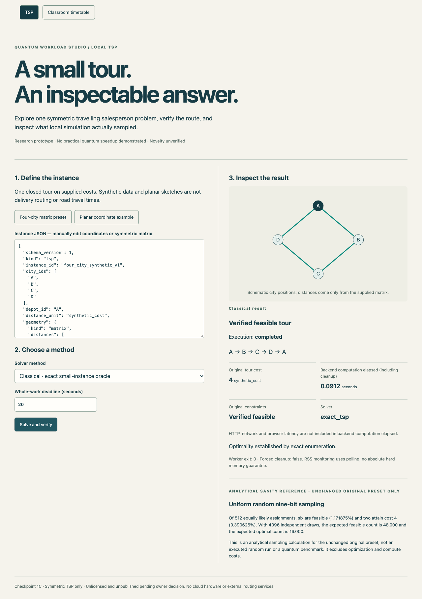
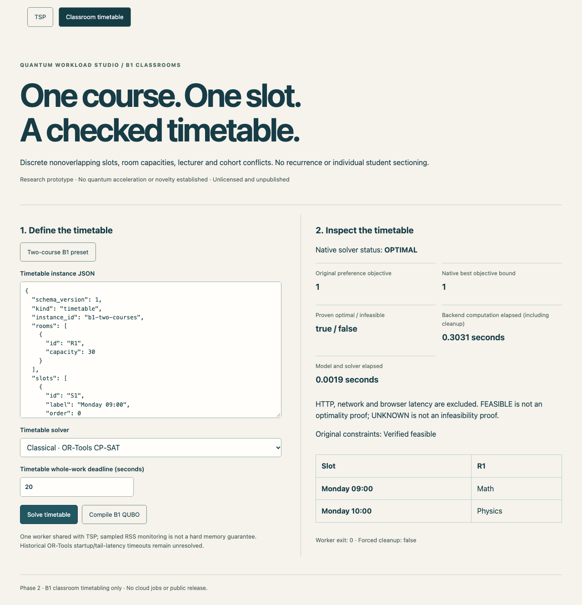

# Ajita

Ajita is a local optimization app for travelling-salesperson problems and classroom timetabling. You can solve an instance, see the route or timetable, and check the result against the original constraints. It also includes QUBO and Ising formulations for exploring how these problems translate to quantum optimization.

## What it does

- **Routes:** solves symmetric TSP instances with OR-Tools or an exact small-instance solver. Accepts a distance matrix or planar coordinates and draws the resulting tour.
- **Timetables:** assigns each course to one room and timeslot, respecting room capacity, lecturer conflicts and cohort conflicts. Uses OR-Tools CP-SAT, with an exhaustive solver for tiny examples.
- **Quantum experiments:** supports optional local Qiskit QAOA for TSP. Reports invalid samples as well as feasible ones, and keeps optimizer status separate from solution quality. Timetabling supports QUBO compilation and verified Ising mapping, **not quantum execution**.

This is a research prototype. Local simulation runs on a classical CPU; no quantum speedup is claimed. Routes use supplied costs, not roads or traffic data. Timetables use single-slot course events, without recurrence or individual student sectioning.

## Screenshots

Four-city TSP, with an exact tour cost of 4:



Two-course timetable, solved with CP-SAT:



These are recorded screenshots of the app, rather than mockups. The timings shown are individual runs, not performance benchmarks.

## Run locally

The tested environment is an Apple Silicon Mac with Python 3.12, Node **24.22.0** and npm **11.19.1**. No cloud account is needed.

```sh
/opt/homebrew/bin/python3.12 -m venv .venv-api
.venv-api/bin/python -m pip install --require-hashes -r requirements/api-macos-arm64-py312.lock
.venv-api/bin/python -m pip install --no-deps --no-build-isolation -e .
npm ci --prefix frontend
```

Start the API:

```sh
QWS_ENABLE_LOCAL_QUANTUM=0 PYTHONPATH=src .venv-api/bin/python -m uvicorn quantum_workload_studio.api.app:app --host 127.0.0.1 --port 8000 --workers 1
```

In another terminal:

```sh
npm --prefix frontend run dev
```

Open **http://127.0.0.1:5173**. Try the four-city preset or switch to Classroom timetable for the two-course example. See [the demo guide](docs/DEMO.md) for a walkthrough and optional simulator setup.

## How it works

The React interface calls a FastAPI service. The API and CLI share the same domain models and classical solver services. Optional QUBO encoders retain variable order, penalties and offsets so their output can be checked independently. Every decoded candidate is validated against the original problem before it is reported as a feasible solution.

[Technical overview](docs/TECHNICAL_OVERVIEW.md) · [Tests and limitations](docs/VERIFICATION.md)

## Limitations

The app is intended for local use, with one active solver worker and explicit size, memory and time limits. It is not an authenticated public service. Worker memory is monitored by polling, so the limits are not hard OS guarantees. Intermittent OR-Tools startup delays have been observed; their cause remains unresolved. Other platforms and remote CI are not yet verified.

The implementation uses established OR-Tools and Qiskit methods. Coding and documentation were assisted by Codex; problem specification, project direction and review were led by the maintainer.

## License

[Apache-2.0](LICENSE).
